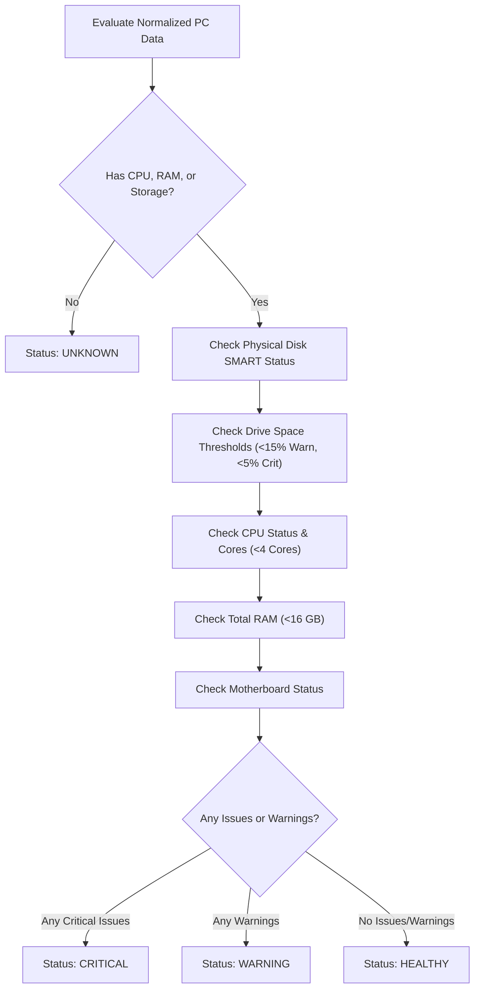

# Chapter 3: Change Detection & Health Analysis Engine

This document explains how the application tracks hardware modifications across historical snapshots and calculates machine health status and upgrade advisories.

---

## 🔍 1. Hardware Change Detector: `parser/change_detector.py`

### 🎯 Purpose
When an IT department collects health check reports periodically (e.g., weekly or monthly), administrators need to know:
- *Did someone add or remove a RAM stick?*
- *Did someone replace a graphics card?*
- *Was a USB flash drive or unauthorized peripheral plugged in?*
- *Did a hard drive get replaced or upgraded?*

The `HardwareChangeDetector` compares a **previous snapshot** against a **current snapshot** of the same machine.

---

### 🔑 Stable Component Identifiers

Hardware devices can appear in any order in text reports. We cannot rely on array index positions (`items[0]`). Instead, `change_detector.py` defines **Stable Identifiers** for each component:

| Component Type | Primary Stable Identifier | Fallback Identifier |
| :--- | :--- | :--- |
| **RAM** | `serial_number` | `device_locator` (e.g. `DIMM1`, `DIMM2`) |
| **Storage Disks** | `serial_number` | `device` (e.g. `\\.\PHYSICALDRIVE0`) |
| **Monitors** | `serial_number` | `model` + `product_code` (e.g. `P2419H_DEL40BB`) |
| **GPU** | `name` + `manufacturer` | `name` |
| **USB Devices** | `pnp_device_id` | `device_id` |
| **Network Adapters** | `mac_address` | `name` |
| **CPU** | `processor_id` | `name` |
| **Keyboards / Mice** | `device_id` | `name` |

---

### ⚙️ The `_compare_list()` Algorithm (Lines 176–241)

The change detection algorithm works in 3 clear steps:

```text
Previous Snapshot (prev_map)           Current Snapshot (curr_map)
----------------------------           ---------------------------
[RAM111: 8GB DDR4]                    [RAM111: 16GB DDR4]   --> MATCHED (CHANGED)
[USB_DEV_1: Mouse]                     -----------------     --> MISSING (REMOVED)
------------------                    [RAM222: 8GB DDR4]    --> NEW     (ADDED)
```

```python
def _compare_list(self, prev_items, curr_items, comp_name, report_date, component_type, get_id, format_item, check_change, collector):
    # Step A: Build fast lookup dictionary maps using stable IDs
    prev_map = {get_id(item): item for item in prev_items}
    curr_map = {get_id(item): item for item in curr_items}

    # Step B: Detect ADDED items (In current, but NOT in previous)
    for item_id, curr_item in curr_map.items():
        if item_id not in prev_map:
            collector.append(HardwareChange(
                date=report_date,
                computer_name=comp_name,
                component_type=component_type,
                change_type="ADDED",
                description=f"Added {component_type}: {format_item(curr_item)}",
                previous_value="N/A",
                current_value=format_item(curr_item)
            ))

    # Step C: Detect REMOVED items (In previous, but NOT in current)
    for item_id, prev_item in prev_map.items():
        if item_id not in curr_map:
            collector.append(HardwareChange(
                date=report_date,
                computer_name=comp_name,
                component_type=component_type,
                change_type="REMOVED",
                description=f"Removed {component_type}: {format_item(prev_item)}",
                previous_value=format_item(prev_item),
                current_value="N/A"
            ))

    # Step D: Detect CHANGED attributes (In both, but key properties differ)
    for item_id in prev_map:
        if item_id in curr_map:
            p_item = prev_map[item_id]
            c_item = curr_map[item_id]
            is_changed, desc = check_change(p_item, c_item)
            if is_changed:
                collector.append(HardwareChange(
                    date=report_date,
                    computer_name=comp_name,
                    component_type=component_type,
                    change_type="CHANGED",
                    description=f"Changed {component_type}: {desc}",
                    previous_value=format_item(p_item),
                    current_value=format_item(c_item)
                ))
```

---

## 🩺 2. Health & Recommendation Engine: `services/health_service.py`

### 🎯 Purpose
Evaluates system telemetry against configurable enterprise thresholds to calculate:
1. Overall Health Status (`HEALTHY`, `WARNING`, `CRITICAL`, `UNKNOWN`).
2. List of Critical Issues and Warnings.
3. Count of Low Storage Partitions.
4. Actionable Hardware Upgrade Recommendations.

---

### 📊 Health Evaluation Workflow (`evaluate_health()`, Lines 30–143)



---

### 🔍 Evaluation Rules Line-by-Line

#### 1. Storage SMART Health Check (Lines 52–63)
- Checks `health_status` and `operational_status` of each physical disk.
- If status is `unhealthy`, `failing`, `error`, `bad`, or `degraded`:
  - Appends to `issues` list: `Storage disk 'Samsung 860' (S/N: S3Z9NB0K) status is Unhealthy / Degraded`.

#### 2. Drive Capacity & Storage Alerts (Lines 64–89)
- Checks `free_percentage` on each partition (e.g. `C:`, `D:`):
  - **$\le 5.0\%$**: Appends to `issues` and creates an **urgent** `UpgradeRecommendation` (`"Urgent: Free up disk space or expand partition on C:"`).
  - **$\le 15.0\%$**: Appends to `warnings` and creates a **warning** `UpgradeRecommendation` (`"Clean up temporary files or expand volume C:"`).

#### 3. CPU Core Count & Status Check (Lines 90–109)
- Checks if CPU reported any hardware fault status.
- Checks if `cores < 4`:
  - If true, appends a warning and generates an upgrade advisory:
    ```python
    UpgradeRecommendation(
        component="CPU",
        reason="System processor has only 2 core(s)",
        current_value="2 cores",
        recommended_action="Consider upgrading to a processor with at least 4 cores"
    )
    ```

#### 4. RAM Capacity Check (Lines 110–120)
- Checks if `total_ram_gb < 16.0`:
  - If true, appends a warning and generates an upgrade advisory:
    ```python
    UpgradeRecommendation(
        component="RAM",
        reason="Total system RAM (8.0 GB) is lower than enterprise standard (16.0 GB)",
        current_value="8.0 GB",
        recommended_action="Upgrade RAM capacity to at least 16.0 GB"
    )
    ```

#### 5. Overall Status Decision (Lines 126–132)
```python
if issues:
    overall = "CRITICAL"
elif warnings:
    overall = "WARNING"
else:
    overall = "HEALTHY"
```
*Result:* Returns a type-safe `HealthStatus` object dictionary ready for display in dashboard badges and tables.
