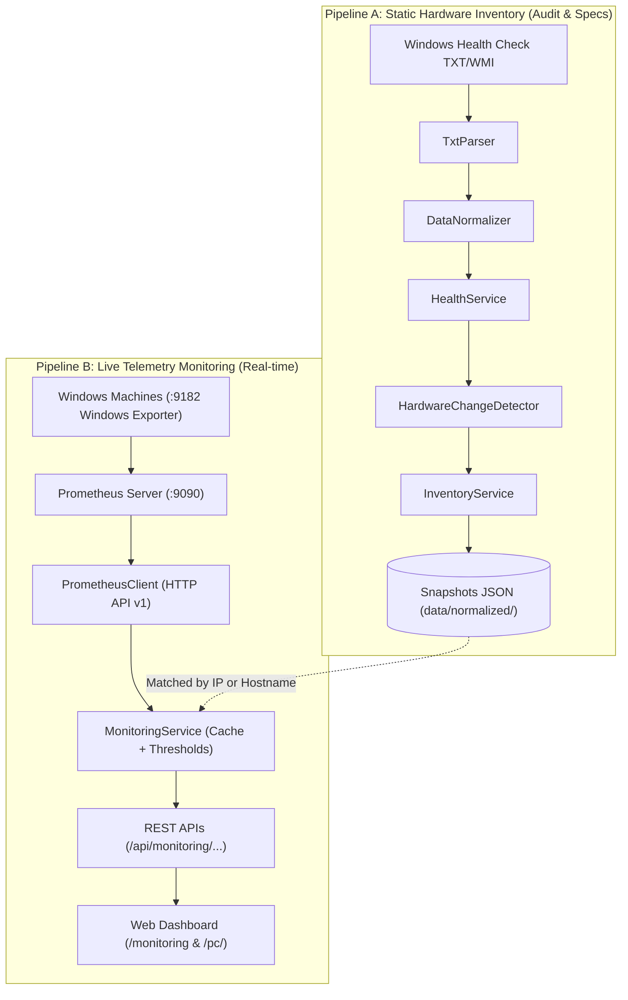

# 📡 Pipeline B: Live Prometheus Monitoring Guide

This document explains the architecture, design, and implementation of **Pipeline B (Live Hardware Monitoring)** integrated into the Hardware Inventory platform.

---

## 1. Architectural Overview: Pipeline A vs Pipeline B

The platform maintains strict separation of concerns between static inventory and live telemetry:



| Dimension | Pipeline A (Inventory) | Pipeline B (Live Monitoring) |
| :--- | :--- | :--- |
| **Data Source** | Windows health-check TXT files | Prometheus HTTP API (`http://172.16.10.38:9090`) |
| **Cadence** | Periodic snapshots (daily/weekly) | Real-time polling (5–15s auto-refresh) |
| **Primary Scope** | Static specs (Motherboard, RAM sticks, BIOS, Serial numbers, installed apps) | Dynamic telemetry (CPU %, RAM %, Disk I/O, Network rates, Uptime, Services) |
| **Storage** | File-based JSON snapshots in `data/` | In-memory TTL cache (time-series stays in Prometheus TSDB) |

---

## 2. Configuration & Environment Variables

Create a `.env` file based on `.env.example`:

| Environment Variable | Default Value | Description |
| :--- | :--- | :--- |
| `PROMETHEUS_URL` | `http://172.16.10.38:9090` | Base URL of the Prometheus server |
| `PROMETHEUS_TIMEOUT` | `5` | Request timeout in seconds |
| `MONITORING_CACHE_TTL_SECONDS` | `10` | In-memory cache duration for current telemetry |
| `CPU_WARNING_PERCENT` | `80.0` | CPU utilization warning threshold |
| `CPU_CRITICAL_PERCENT` | `95.0` | CPU utilization critical threshold |
| `MEMORY_WARNING_PERCENT` | `85.0` | RAM utilization warning threshold |
| `MEMORY_CRITICAL_PERCENT` | `95.0` | RAM utilization critical threshold |
| `DISK_WARNING_PERCENT` | `85.0` | Logical disk warning threshold |
| `DISK_CRITICAL_PERCENT` | `95.0` | Logical disk critical threshold |
| `MONITORED_SERVICES` | `Spooler,LanmanServer,wuauserv,EventLog` | Monitored Windows service names |
| `MONITORED_PROCESSES` | `chrome.exe,sqlservr.exe,postgres.exe` | Tracked executable watchlist |

---

## 3. PromQL Queries & Metric Mappings

All telemetry is queried directly through the Prometheus HTTP API (`/api/v1/query` and `/api/v1/query_range`):

### Target Discovery
```promql
up{job="windows"}
```
- `up == 1`: Target is online and scraping succeeds.
- `up == 0`: Scrape failed or machine is unreachable. **Rule:** Classified as `OFFLINE / UNREACHABLE`, not hardware failure.

### CPU Utilization (%)
Calculated by inverting idle core time over a 5-minute rate window:
```promql
100 - (avg by (instance) (rate(windows_cpu_time_total{mode="idle", instance="<INSTANCE>"}[5m])) * 100)
```

### Physical Memory (RAM)
Windows Exporter exposes total physical memory and free physical memory:
```promql
Total: windows_cs_physical_memory_bytes{instance="<INSTANCE>"}
Free:  windows_os_physical_memory_free_bytes{instance="<INSTANCE>"}
Used % = 100 * (1 - (Free / Total))
```

### Logical Disk Usage (per volume)
Preserves volume identity (`C:`, `D:`, `E:`):
```promql
Total: windows_logical_disk_size_bytes{instance="<INSTANCE>"}
Free:  windows_logical_disk_free_bytes{instance="<INSTANCE>"}
Used % = 100 * (1 - (Free / Total))
```

### Disk I/O Rates & Queue
```promql
Read Bytes/sec:   sum(rate(windows_logical_disk_read_bytes_total{instance="<INSTANCE>"}[5m]))
Write Bytes/sec:  sum(rate(windows_logical_disk_write_bytes_total{instance="<INSTANCE>"}[5m]))
Read Ops/sec:     sum(rate(windows_logical_disk_reads_total{instance="<INSTANCE>"}[5m]))
Write Ops/sec:    sum(rate(windows_logical_disk_writes_total{instance="<INSTANCE>"}[5m]))
Requests Queued:  sum(windows_logical_disk_requests_queued{instance="<INSTANCE>"})
```

### Network Traffic Rates
```promql
Receive Rate: rate(windows_net_bytes_received_total{instance="<INSTANCE>"}[5m])
Send Rate:    rate(windows_net_bytes_sent_total{instance="<INSTANCE>"}[5m])
```

### System Uptime
`windows_system_system_up_time` reports the system boot Unix timestamp. Uptime in seconds is calculated as:
```promql
time() - windows_system_system_up_time{instance="<INSTANCE>"}
```

### Windows Service States
> [!IMPORTANT]
> **Label Collision Resolution:** Because Prometheus scrape configs assign the target label `name="<PC_NAME>"` (e.g. `name="2F-S02"`), Prometheus renames the service metric label `name` to `exported_name`. The query handles both `exported_name` and `name`:
```promql
windows_service_state{instance="<INSTANCE>", exported_name=~"(?i)Spooler|LanmanServer|wuauserv|EventLog"} == 1
```

### Processes & Temperature Availability
- **Processes:** Exposes total active system process count via `windows_os_processes{instance="<INSTANCE>"}`. Per-process CPU/RAM collectors are not enabled on these machines to prevent high metric cardinality.
- **Temperature:** No thermal zone temperature sensors are exported by Windows Exporter on these machines. Per specifications, temperature returns `null` and displays as `N/A`.

---

## 4. REST API Reference

### 1. Discover Monitoring Targets
`GET /api/monitoring/targets`
- **Query Parameters:** `refresh=1` (optional, bypasses 10s cache)
- **Response:**
```json
{
  "count": 2,
  "data": [
    {
      "name": "2F-S02",
      "instance": "172.16.10.157:9182",
      "job": "windows",
      "online": true
    },
    {
      "name": "Lokesh",
      "instance": "172.16.10.34:9182",
      "job": "windows",
      "online": false
    }
  ]
}
```

### 2. Get Current Live Metrics
`GET /api/monitoring/{instance}/current`
- **Example:** `/api/monitoring/172.16.10.157:9182/current`
- **Response (Online):**
```json
{
  "name": "2F-S02",
  "instance": "172.16.10.157:9182",
  "online": true,
  "status": "ONLINE",
  "status_detail": "Operating normally",
  "metrics": {
    "cpu_percent": 7.45,
    "memory_percent": 56.11,
    "memory_available_bytes": 3685634048,
    "memory_total_bytes": 8398024704,
    "disk_percent": 32.38,
    "disk": [
      {
        "drive": "C:",
        "total_bytes": 315043610624,
        "free_bytes": 213041283072,
        "used_percent": 32.38
      }
    ],
    "disk_io": {
      "read_bytes_sec": 32923.7,
      "write_bytes_sec": 50414.9,
      "read_ops_sec": 0.43,
      "write_ops_sec": 3.68,
      "requests_queued": 0
    },
    "network_receive_bytes_sec": 3511.0,
    "network_send_bytes_sec": 1576.3,
    "uptime_seconds": 1733387,
    "uptime_display": "20d 02h 53m",
    "services": [
      {"service": "Spooler", "status": "running"},
      {"service": "LanmanServer", "status": "running"}
    ],
    "processes": {
      "total_count": 203,
      "monitored": [{"process": "chrome.exe", "status": "monitored"}]
    },
    "temperature": null
  },
  "timestamp": 1788846503
}
```

- **Response (Offline / Unreachable):**
```json
{
  "name": "Lokesh",
  "instance": "172.16.10.34:9182",
  "online": false,
  "status": "OFFLINE",
  "status_detail": "Monitoring unreachable / Exporter offline",
  "metrics": {
    "cpu_percent": null,
    "memory_percent": null,
    "disk_percent": null,
    "network_receive_bytes_sec": null,
    "network_send_bytes_sec": null,
    "uptime_seconds": null,
    "uptime_display": "N/A",
    "services": [],
    "processes": null,
    "temperature": null
  },
  "timestamp": 1788846503
}
```

### 3. Historical Telemetry (Time-Series)
`GET /api/monitoring/{instance}/history?metric={cpu|memory|network_rx|network_tx|disk_read|disk_write}&range={1h|6h|24h}&step=60s`
- **Response:**
```json
{
  "instance": "172.16.10.157:9182",
  "metric": "cpu",
  "range": "1h",
  "step": "60s",
  "start": 1788842903,
  "end": 1788846503,
  "points_count": 61,
  "data_points": [
    {"timestamp": 1788842903, "value": 6.82},
    {"timestamp": 1788842963, "value": 7.15}
  ]
}
```

---

## 5. Security & Query Protection

1. **PromQL Encapsulation:** Public REST endpoints do not accept raw PromQL strings. Pre-defined query templates are strictly parametrized inside `MonitoringService`.
2. **Instance Validation:** The `instance` parameter is validated against `^[0-9a-zA-Z\.\-_]+:\d+$` to prevent label injection.
3. **No Direct Frontend-to-Prometheus Communication:** Browsers communicate exclusively with the Flask backend; the Prometheus URL (`172.16.10.38:9090`) is never exposed in browser network requests.
4. **Structured Error Masking:** Stack traces and internal network topology are never returned in JSON error responses.

---

## 6. How to Test via Postman or cURL

### 1. Test Target Discovery
```bash
curl -s http://127.0.0.1:5000/api/monitoring/targets
```

### 2. Test Live Metrics (Online Target)
```bash
curl -s http://127.0.0.1:5000/api/monitoring/172.16.10.157:9182/current
```

### 3. Test Live Metrics (Offline Target)
```bash
curl -s http://127.0.0.1:5000/api/monitoring/172.16.10.34:9182/current
```

### 4. Test Historical CPU Utilization
```bash
curl -s "http://127.0.0.1:5000/api/monitoring/172.16.10.157:9182/history?metric=cpu&range=1h"
```

---

## 7. Troubleshooting

| Issue | Root Cause | Solution |
| :--- | :--- | :--- |
| `PROMETHEUS_UNAVAILABLE` | Prometheus service stopped or firewall blocking port 9090 | Verify Prometheus is running on `172.16.10.38:9090`. Test with `curl http://172.16.10.38:9090/api/v1/query?query=up`. |
| Target shows `OFFLINE` | Windows Exporter stopped on remote PC or port 9182 blocked | Start Windows Exporter service on target machine: `Start-Service windows_exporter`. Verify firewall allows TCP 9182. |
| Services show `not found` | Service name typo or service not running | Check `MONITORED_SERVICES` in `.env`. Ensure service names match exact Windows service identifier (e.g. `Spooler`). |
| High Prometheus Load | Excessively fast refresh interval with multiple open tabs | The application includes a 10s in-memory cache and utilizes the HTML5 Page Visibility API to automatically pause polling when the browser tab is hidden. |
