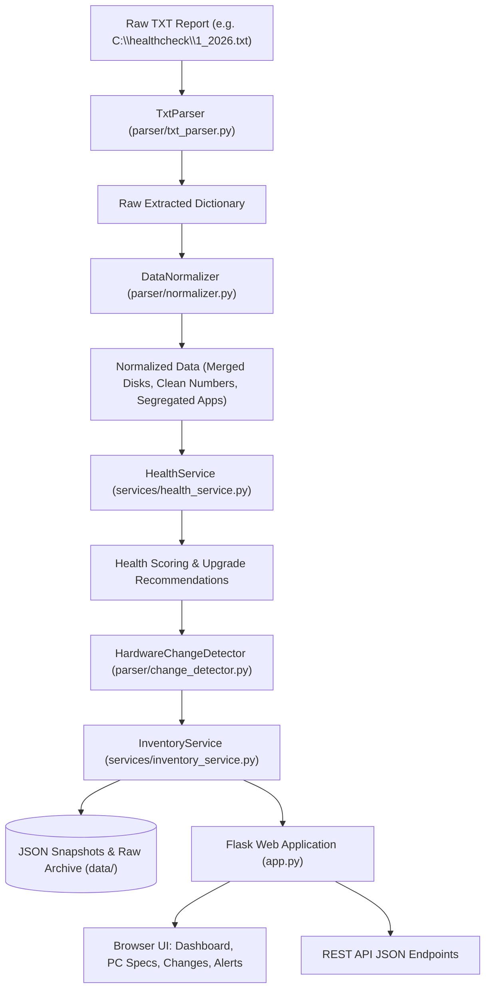

# 📚 Codebase Explanation & Beginner's Guide

Welcome to the comprehensive code explanation guide for the **Python Hardware Inventory & Health Check Platform**.

This folder is designed specifically for beginners, developers, and system administrators who want to understand **every line of code**, the **system architecture**, and the **end-to-end data lifecycle**.

---

## 🗺️ Table of Contents & Learning Path

Follow these documents in order for the smoothest learning experience:

| Guide | Title | Description |
| :--- | :--- | :--- |
| **[01. Architecture & Workflow](./01_ARCHITECTURE_AND_WORKFLOW.md)** | **System Overview & Data Lifecycle** | Explains the big picture: High-level MVC + Repository architecture, end-to-end data flow (from TXT file to browser table), and beginner primer on Python features used. |
| **[02. Parser & Normalizer](./02_CORE_PARSER_AND_NORMALIZER.md)** | **Parsing Engine (`txt_parser.py` & `normalizer.py`)** | Line-by-line explanation of how unstructured `.txt` health reports are converted into structured, type-safe dictionaries and how disk health data is merged. |
| **[03. Change Detector & Health](./03_CHANGE_DETECTION_AND_HEALTH.md)** | **Intelligence Engine (`change_detector.py` & `health_service.py`)** | Line-by-line breakdown of stable hardware identifiers, ADDED/REMOVED/CHANGED algorithms, health grading, and upgrade advisories. |
| **[04. Services & Config](./04_SERVICES_AND_DATABASE.md)** | **Repository & Config (`inventory_service.py`, `config.py`, `schemas.py`)** | Line-by-line explanation of the repository pattern, filesystem snapshot storage, duplicate prevention, rotating logging, and dataclass schemas. |
| **[05. Web App & Frontend](./05_WEB_APP_AND_FRONTEND.md)** | **Flask UI & JavaScript (`app.py`, templates, CSS, JS)** | Line-by-line explanation of Flask application factory, web routes, REST API endpoints, Jinja2 template inheritance, CSS styles, and vanilla JS live search/drag-and-drop. |
| **[06. Prometheus Monitoring](./06_PROMETHEUS_MONITORING_PIPELINE_B.md)** | **Pipeline B: Live Monitoring & Prometheus Telemetry** | Complete architecture, PromQL query mappings, Prometheus client, metric calculations, REST APIs, and live telemetry UI integration. |

---

## 💡 Quick High-Level Summary

---

*Select any of the guides above to start learning!*
